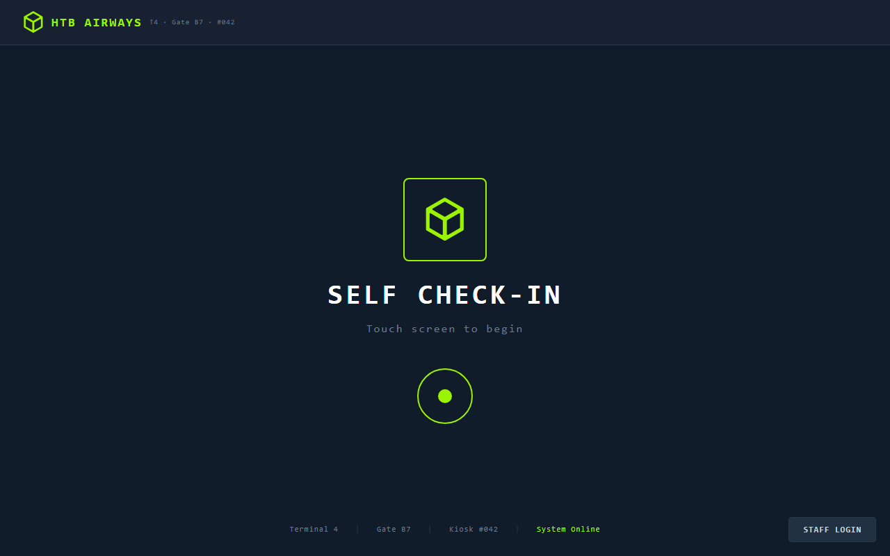
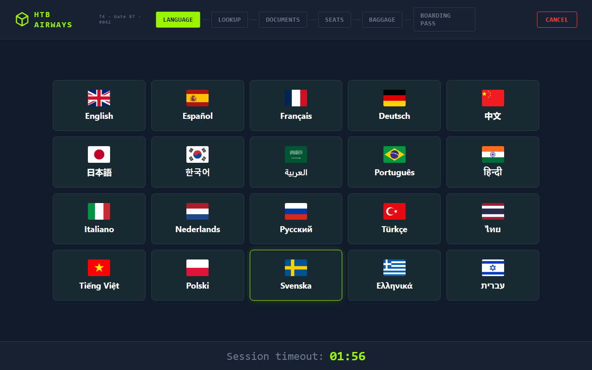

# HTB Touch — 用 `/goal` 自己開 RDP 看圖點按鈕 — Agentic RDP via /goal

> [!NOTE]
> 2026-10-13 用 Claude Code `/goal` 跑 HTB **Touch** (10.129.4.252, hostname `KIOSK-042`), 吃到 Web → KioskUser 憑證之後, 卡在 **Windows Assigned Access 的 kiosk 應用**裡 — 沒 shell, 只有一個全螢幕瀏覽器. 這份 note 的重點不是「有沒有拿到 flag」(**沒有**), 而是展示 agent **自己開 RDP 連線、把畫面拍下來看、再自己送點擊/鍵盤事件**的工具鏈怎麼串出來, 以及 Mythos 5.1 的 safeguard 中段擋人之後我放棄接 Opus 5 的時間決策.

> **TL;DR (EN):** HTB **Touch** (hostname KIOSK-042). Not a win (kiosk escape failed), but the interesting part is tooling: Claude agent built a four-piece headless RDP stack — `xfreerdp /sec:rdp` to connect without NLA, `Xvfb` to host the window in a virtual display, `xdotool` to send clicks/keys, `ImageMagick import` to screenshot the virtual display. Agent then reads screenshots back visually to decide next click. Mid-goal, Mythos 5.1 hit `cyber-related safeguards`; I switched to Opus 5 but it was taking too long so I abandoned — this folder keeps only the Mythos 5.1 artifacts.

---

## 心智清單 — Mind-Map

```markdown
# Agent 自己開 RDP, 看圖點按鈕 — 工具鏈 + 中途放棄
* 現況
  * Web 進去, 拿到 KioskUser / K!0sk2026#
  * RDP 連得上, 但卡在 Windows Assigned Access kiosk
  * 沒 shell, 沒 flag
* RDP 自動化工具鏈
  * xfreerdp /sec:rdp /cert:ignore (繞 NLA)
  * Xvfb :99 當虛擬螢幕
  * xdotool 送 click + key
  * ImageMagick import 截 PNG 給 agent 讀
* Mythos 5.1 safeguard 中段擋
  * badge 格式嘗試到一半被擋
  * 切 Opus 5 繼續
  * 太慢我手動放棄
* 這份 note 的範圍
  * 只保留 Mythos 5.1 階段紀錄
  * 工具鏈作法完整寫
  * kiosk escape 當 pending 未來再回
```

---

## 本次目標與結果 — Target & Result

| 項目 | 內容 |
|:---|:---|
| 日期 | 2026-10-13 (11:19 – 11:55 CST, 約 36 分鐘, 未完成) |
| 靶機 | HTB **Touch** (10.129.4.252, hostname `KIOSK-042`, Windows 11 / Server 2025 Build 26100) |
| 攻擊面 | 8443 HTTP 管理介面 + 3389 RDP (Native, 無 NLA) + 5985 WinRM |
| 使用模型 | **Claude Mythos 5.1** (後來撞 safeguard, 切 Opus 5 太慢放棄) |
| 已拿到 | Web dashboard + `KioskUser / K!0sk2026#` + RDP kiosk 畫面 |
| **沒拿到** | shell / `local.txt` (卡在 kiosk 逃逸) |
| 這份 note 的紀錄範圍 | **只有 Mythos 5.1 階段**, Opus 5 續跑的部分沒保留 |

---

## 共用的 CLAUDE.md — Shared Rules Across All HTB Runs

Cap / Touch / Management 這三場 HTB 都是用同一份 `CLAUDE.md`. `/goal` 只負責**單次任務**的目標 + Phase + stop 條件, CLAUDE.md 負責**跨任務**的 agent 行為紀律. 原始全文:

```markdown
# CLAUDE.md

## Environment
- OS: Ubuntu (standard install, pentest tools may be missing)
- HTB VPN active on tun0
- My IP and Target IP are set in the current /goal

## Tool installation policy
If any tool is not found, install it before proceeding:
- apt-based: sudo apt install -y <tool>
- Python: pip3 install <package>
- Go tools: go install <repo>@latest
- Binary releases: download from GitHub releases to /usr/local/bin/

## Logging rules
- Working directory: ~/htb/machine-name/
- All tool output: saved under ./recon/ using tee
- Notes and summaries: ./recon/notes.md
- Flag storage: ./recon/flags.txt
- Never run a command without capturing its output

## Stop condition
Read local.txt → record to recon/flags.txt → STOP
Do not escalate privileges until next session

## INTEGRITY RULES (CRITICAL):
- Do NOT search the internet for writeups, CVE PoCs from external sites, or published solutions for this specific machine.
- Research general technique syntax (e.g. "sqlmap usage") is allowed, but looking up this machine's solution is not.
- NO credential brute force with wordlists (no hydra/medusa on SSH/FTP)
- ALL commands must be fully non-interactive (no vim, python REPL, mysql interactive)
```

Touch 這場更能看出 CLAUDE.md 的「tool installation policy」帶來的紅利: agent 遇到 kiosk 要操作時, 自己 `apt install xfreerdp2 xvfb xdotool imagemagick` 把 RDP 工具鏈裝起來. 這一步**沒有寫在 `/goal` 的 prompt 裡**, agent 自己判斷「缺工具就裝」是因為 CLAUDE.md 給了許可. 下面「Agentic RDP 工具鏈」那段能發生, 這份 CLAUDE.md 是前提條件.

---

## 最有趣的部分 — Agentic RDP 工具鏈

這台靶機逼 agent 進一個**全螢幕瀏覽器 kiosk**裡. 傳統 pentest 這段靠人操作 — 連 RDP、看到介面、滑鼠亂點找 bug. 但 `/goal` 是**命令列 agent**, 怎麼辦? 答案是**自己組一條 headless GUI 自動化 pipeline**:

```
┌─────────────────────────────────────────────────────────────────┐
│  Claude Code agent (text-only CLI)                              │
│                                                                 │
│  ┌─────────┐  啟動 ┌──────────────┐  連線 ┌──────────────────┐  │
│  │ Xvfb :99│◄─────│ xfreerdp     │─────►│ 10.129.4.252:3389│  │
│  │ 虛擬螢幕│      │ /sec:rdp     │       │ KIOSK-042 Win    │  │
│  └────┬────┘      └──────────────┘       └──────────────────┘  │
│       │ RDP window 畫在 Xvfb                                    │
│       ▼                                                         │
│  ┌─────────┐  截圖  ┌──────────────┐                           │
│  │ import  │─────► │ rdp_shots/   │                           │
│  │ (IM)    │       │ s01.png ...  │                           │
│  └─────────┘       └──────┬───────┘                           │
│                           │ Read tool 讀回來                   │
│                           ▼                                     │
│                    ┌─────────────┐                              │
│                    │ Agent 看圖  │  決定下一步座標 / 按鍵     │
│                    └──────┬──────┘                              │
│                           │                                     │
│                           ▼                                     │
│                    ┌─────────────┐  click / key                 │
│                    │ xdotool     │─────► 送到 Xvfb :99          │
│                    └─────────────┘      送到 xfreerdp 視窗      │
│                                        → 透過 RDP 送到靶機     │
└─────────────────────────────────────────────────────────────────┘
```

### 四個工具各做什麼

| 工具 | 角色 | 關鍵指令 |
|:---|:---|:---|
| **xfreerdp** | RDP client. 這台靶機只允許 Native RDP (RC4), 不吃 NLA / TLS, 所以要加 `/sec:rdp` 強制 | `xfreerdp /v:10.129.4.252 /u:KioskUser /p:'K!0sk2026#' /sec:rdp /cert:ignore` |
| **Xvfb** | X Virtual Frame Buffer. 沒有實體顯示器也能跑 X11 的「虛擬螢幕」, agent 把 RDP 畫到這裡 | `Xvfb :99 -screen 0 1280x768x24 &` + `export DISPLAY=:99` |
| **xdotool** | 用程式送 X11 的滑鼠/鍵盤事件. 送到 `:99` 等於送進 xfreerdp 的 window | `xdotool mousemove 1197 762 click 1` (點 STAFF LOGIN) · `xdotool key Return` |
| **ImageMagick `import`** | 截 X11 window 成 PNG, 存檔讓 agent 讀. 也可以用 `xwd` 但 `import` 直接出 PNG | `import -window root -display :99 rdp_shots/s03.png` |

全部**都是 Linux 標準套件**, `apt install xfreerdp2 xvfb xdotool imagemagick` 一行搞定. 沒有 "cloud browser"、沒有 playwright-for-rdp、沒有商業產品.

### 典型一輪 agentic loop

```bash
# 0) 一次性: 開虛擬螢幕 + RDP
Xvfb :99 -screen 0 1280x768x24 &
sleep 1
DISPLAY=:99 xfreerdp /v:10.129.4.252 /u:KioskUser \
    /p:'K!0sk2026#' /sec:rdp /cert:ignore /size:1280x768 &
sleep 5                          # 等 kiosk app 載入

# 以下迴圈由 agent 反覆跑, 每輪 「截圖 → 讀圖 → 決定動作 → 執行」:

# 1) 截圖
import -window root -display :99 recon/rdp_shots/s03.png

# 2) agent 用 Read tool 讀 s03.png 回來, 看到「STAFF LOGIN」按鈕在右下

# 3) 送點擊
DISPLAY=:99 xdotool mousemove 1197 762 click 1

# 4) 等頁面反應
sleep 1

# 5) 再截下一張, 回 step 1
import -window root -display :99 recon/rdp_shots/s04.png
```

agent 每一步都用自己的視覺理解 (Claude 讀 PNG) 決定下一個座標. **這套流程本質跟 OpenAI Operator / Anthropic Computer Use 一樣, 只是 agent 自己用 3 個 CLI 工具組出來**, 不依賴任何 "browser automation" 抽象.

### 這個 session 的 10 張截圖

全部放在同資料夾 `rdp-s01.png` – `rdp-s10.png`:

| 截圖 | 畫面 | 下一步動作 |
|:---|:---|:---|
| rdp-s01 | 待機頁「SELF CHECK-IN · Touch screen to begin」 | 點右下 STAFF LOGIN |
| rdp-s02-03 | STAFF LOGIN → Staff Authentication 畫面 | 點 SCAN BADGE |
| rdp-s04 | **Invalid badge format** 錯誤 (QR 格式一直猜不中) | 回 Back |
| rdp-s05 | 待機頁點進 self check-in | 挑 LANGUAGE |
| rdp-s06 | **語言選單** (20 國語言 + session timeout 01:56) | 挑 English |
| rdp-s07-10 | LOOKUP → DOCUMENTS → SEATS → BAGGAGE 的 kiosk flow | 試點每一個欄位, 看能不能 escape |




### 卡在哪 — xdotool 鍵盤輸入失效

RDP kiosk 的 **文字輸入欄位會彈出畫面上的虛擬鍵盤**. agent 用 `xdotool type` 送實體鍵盤輸入, 字沒出現在欄位裡 — 可能是 Windows kiosk 攔了實體鍵盤事件, 或輸入時機沒對準 focus. 這條沒 debug 完就撞到 safeguard 停手.

---

## Mythos 5.1 中段撞 safeguard — 跟 Cap / Management 一樣的 pattern

同一天跑的 [Cap](../cap-2026-10-13/cap-with-goal.md) 跟 [Management](../management-2026-10-13/management-with-goal.md) 都遇到過. 這次是**第三次**撞:

- 進 Web 管理介面、拿到 KioskUser 憑證、連進 RDP、截圖、試點 — 這些 Mythos 都沒事
- 卡在 badge 格式**猜不出來**時, agent 開始暴力試 60+ 種 QR 內容 (JSON / base64 / JWT / `NX-xxxx` / GUID 分隔字串...), 又去研究 MRZ (護照機讀碼) 編碼
- 某一輪繼續猜 badge format 的 payload 時, Mythos 5.1 回:

```
API Error: Mythos 5.1's safeguards flagged this message.
```

跟前兩台的觀察一致 — **單句不犯規, 整段 context 攻擊意圖密度高到一定程度就擋**. 這次觸發點是**連續 60 次嘗試偽造認證 token** 這類訊號累積.

### 這次的時間決策 — 不接 Opus 5 續跑

處理方式試了跟 [Management 那次](../management-2026-10-13/management-with-goal.md#52-分鐘的時間花在哪--foothold-timeline)一樣: `/model` 切 Opus 5 續跑. 但這次情況不一樣:

- Management 的 Mythos **已經把 95% 的功做掉** (classpath enum, JMX 入口, GLPI 位置都定位了), Opus 5 收尾只 1 分鐘
- Touch 的 Mythos **還卡在 badge 猜謎 + kiosk escape** 兩條都沒眉目, Opus 5 一樣要從頭爆打
- Opus 5 載入 context + 開始推理花了一段時間, 我**手動按停放棄**

結論: safeguard 擋人之後, **先看 Mythos 已經把題目推到多深**才決定要不要換模型. 把題目**推進到 90% 以上**時換模型最賺 (Opus 5 直接收尾); 停在 30-40% 時換模型等於**整段重跑**, 等的時間可能大於自己接手手動幹.

這份 note 的 `recon/` 只有 Mythos 5.1 的紀錄, 就是因為放棄後沒截 Opus 5 的輸出.

---

## 已經確認的攻擊面 — Known Surface

| 項目 | 細節 |
|:---|:---|
| 管理介面 | `http://10.129.4.252:8443` ("Nexion DeviceHub"), .NET HttpListener |
| 管理密碼 | `NX-DH-2024-B7042` (= 從未驗證端點 `/api/status` 洩漏的裝置序號) |
| Dashboard 洩漏憑證 | **KioskUser / K!0sk2026#** (`toggleCred()` 直接秀在 HTML + `/api/scanner`/`/api/printer` JSON) |
| 本機服務 | `localhost:5173` 疑似 Vite dev server (kiosk 前端, 未對外) |
| RDP | 僅 Native RDP (RC4), 無 NLA/TLS, `/sec:rdp` 可連 |
| WinRM | KioskUser 被 401 擋 (非 Remote Management Users) |
| Kiosk 應用 | Windows Assigned Access 全螢幕瀏覽器, 全英文 kiosk UI, Session timeout ~2 分鐘 |

**還沒解的**:
- `/login/badge` 的合法 QR 格式 (60+ 種試過都 "Invalid badge format")
- kiosk escape (無法用 xdotool 鍵盤進欄位, 虛擬鍵盤接管了實體輸入)
- `localhost:5173` 的 kiosk 前端原始碼 (可能藏 badge 格式線索)

---

## 感想 — Takeaways

- **agentic RDP 這條工具鏈值得單獨記下來**. 以後要 agent 操作任何 GUI (Windows / 瀏覽器 / X11 app), 都是這組 Xvfb + xdotool + import 的變形. 不用等 Anthropic 把 Computer Use 推出完整產品 — Linux 這套 1990 年代的 X11 工具就夠組出來了
- **agent 看圖決定座標的手感**: 跟人類 pentest 時用 Burp 看回應決定下一步一樣, 只是**介面從 HTTP response 換成了 PNG**. Claude 讀圖的能力好到可以直接說「STAFF LOGIN 在右下角 (約座標 1197, 762)」, 不用 OCR 或 element inspector
- **safeguard 跟題目推進度要配合看**: 這次放棄接 Opus 5 的判斷是對的 — 題目還早, 接續的時間可能大於手動幹的時間. Cap/Management 那兩次推到 90% 以上才換, 1 分鐘內收尾
- **這台靶機應該不難**: Touch 這類題名直白暗示重點在 **touch screen 操作** (kiosk UI + 可能的 badge 識別), 真實 writeup 應該直接從 kiosk 前端 (`localhost:5173`) 的 JS 原始碼找 badge 格式線索. agent 無網查 + 沒進到 kiosk 前端 source = 死路

---

## Sources

- [Cap 案例 (同系列前篇, 短版 easy)](../cap-2026-10-13/cap-with-goal.md)
- [Management 案例 (同系列前篇, Insane 版)](../management-2026-10-13/management-with-goal.md)
- [HTB Goal Prompt 設計指南](../htb-goal-prompt-guide.md)
- [FreeRDP `/sec:rdp` 選項文件](https://github.com/FreeRDP/FreeRDP/wiki/CommandLineInterface)
- [Xvfb(1) man page](https://man.archlinux.org/man/Xvfb.1.en) — virtual framebuffer X server
- [xdotool 官方文件](https://github.com/jordansissel/xdotool) — X11 自動化鍵鼠輸入
- [ImageMagick `import` manual](https://imagemagick.org/script/import.php) — 截 X11 window 成 PNG
